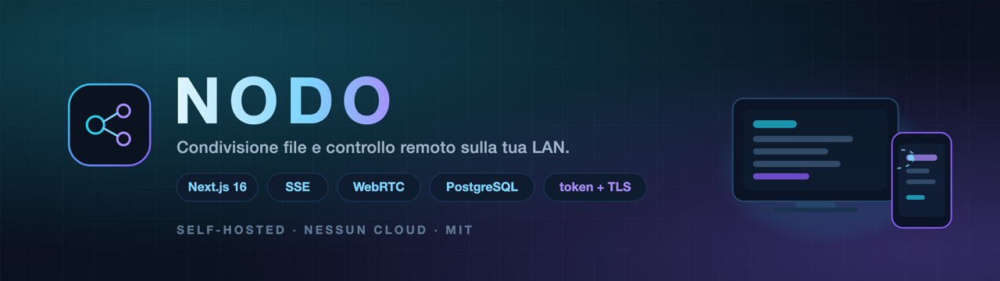
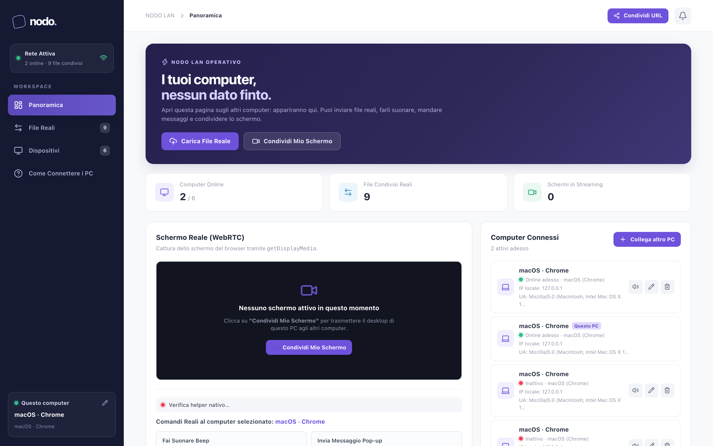

[](LICENSE)


**NODO** trasforma i computer della tua rete locale in un unico workspace: trascini un file
dal PC e lo trovi sull'altro, vedi lo schermo remoto, muovi il mouse vero, mandi un link
da aprire. Tutto in casa tua, senza cloud e senza account.



---

## Indice

- [Caratteristiche](#caratteristiche)
- [Come funziona](#come-funziona)
- [Requisiti](#requisiti)
- [Avvio rapido](#avvio-rapido)
- [Collegare un altro computer](#collegare-un-altro-computer)
- [Sicurezza](#sicurezza)
- [Architettura](#architettura)
- [API](#api)
- [Script](#script)
- [Database e migrazioni](#database-e-migrazioni)
- [Controllo remoto nativo (helper)](#controllo-remoto-nativo-helper)
- [Configurazione](#configurazione)
- [Risoluzione problemi](#risoluzione-problemi)
- [Limiti noti](#limiti-noti)
- [Licenza](#licenza)

## Caratteristiche

- **File veri, non finti.** Gli upload finiscono in `data/uploads/` e si scaricano in
  streaming: nessun blob nel database, nessun file caricato per intero in memoria.
- **Schermo remoto via WebRTC.** Condivisione dello schermo peer-to-peer con controllo
  tramite mouse e tastiera, tastiera virtuale per i caratteri speciali.
- **Input di sistema reale.** Un piccolo helper locale (`helper/input-agent.mjs`) muove il
  mouse vero del PC remoto, non solo il cursore dentro la pagina.
- **Aggiornamenti in tempo reale con SSE.** Un solo stream apre dispositivi, file e
  segnali: niente polling ogni secondo.
- **Accesso con token condiviso.** Le API di lettura e scrittura richiedono un token;
  il primo dispositivo si accoppia da solo, gli altri ricevono un link con token.
- **TLS in casa.** Proxy HTTPS con certificato self-signed generato al volo, necessario
  per `getDisplayMedia` e per non far viaggiare il token in chiaro.
- **Comandi remoti.** Apri un URL sul PC remoto, invia un messaggio, leggi un appunto,
  fai suonare un avviso.
- **Zero servizi esterni.** Basta un PostgreSQL (Neon, Supabase o locale) e Node.

## Come funziona

```
Browser A (PC1)                 Server NODO (PC1)                 Browser B (PC2)
   │                                   │                                │
   ├── SSE /api/events ───────────────►│◄──────── SSE /api/events ──────┤
   │   (dispositivi + file)            │                                │
   ├── POST /api/signals ─────────────►│  segnali WebRTC (offer/answer) │
   │                                   │◄────── GET /api/signals ───────┤
   ├══ WebRTC media + data channel ════════════════════════════════════►│
   │                                   │                                │
   │                         PostgreSQL (metadati)                     │
   │                         data/uploads (file)                       │
```

Il server è solo un ponte per i segnali: l'immagine dello schermo viaggia diretto tra i
due browser (quando la rete lo permette), quindi non consuma banda del server.

## Requisiti

- **Node.js ≥ 20.9** (Next.js 16)
- **PostgreSQL** ≥ 14 (Neon, Supabase o installazione locale)
- Un browser Chromium/Firefox aggiornato
- Per il controllo nativo: macOS, Windows o Linux con l'helper installato

## Avvio rapido

```bash
git clone https://github.com/jeaders/localsharefile.git
cd localsharefile

npm install
cp .env.example .env       # inserisci DATABASE_URL
npm run db:migrate         # tabelle, indici, migrazione dei vecchi blob su disco

npm run server             # build se serve, certificato TLS, proxy HTTPS, apre il browser
```

`npm run server` stampa gli indirizzi della rete:

```
[NODO] Proxy HTTPS su porta 3443 (modalità produzione)
[NODO] Apri uno di questi indirizzi dagli altri dispositivi:
  - https://192.168.1.63:3443
```

Per fermare tutto: `npm run server:stop`.

In sviluppo, con hot reload:

```bash
npm run dev          # http://localhost:3000
npm run dev:https    # https://localhost:3443 (proxy HTTPS, serve per la condivisione schermo)
```

> La condivisione dello schermo richiede un **contesto sicuro**: `localhost` oppure HTTPS.
> Da un altro PC apri sempre l'URL `https://…` e accetta l'avviso del certificato la prima volta.

## Collegare un altro computer

1. Sulla macchina del server, apri NODO: l'accoppiamento è **automatico** (richiesta da loopback).
2. Premi **Condividi URL**: il link copiato contiene il token, es. `https://192.168.1.63:3443/?token=…`.
3. Incollalo sull'altro PC: viene accoppiato al primo accesso e il token finisce in un cookie.

Il token vive in `data/nodo-token` (permessi `600`) oppure in `NODO_TOKEN`. Per revocare
tutti gli accessi: cancella il file (o cambia `NODO_TOKEN`) e riavvia; i dispositivi vanno
riaccoppiati.

## Sicurezza

Cosa fa NODO:

| Protezione | Dove |
|---|---|
| Token obbligatorio su tutte le API dati | `src/lib/auth.ts`, `requireAuth()` |
| Confronto in tempo costante del token | `timingSafeEqual` |
| Cookie `SameSite=Lax` (+ `Secure` dietro HTTPS) | `/api/pairing` |
| Accoppiamento automatico **solo** da loopback | `isLoopbackRequest()` |
| `X-Forwarded-For` fidato solo perché Next ascolta su `127.0.0.1` | `https-proxy.ts` |
| Helper: allowlist di origini locali + token | `helper/input-agent.mjs` |
| Validazione di URL/comandi remoti (niente `javascript:`) | `/api/signals` |
| Header `nosniff`, `DENY`, `no-referrer`, `Permissions-Policy` | `next.config.ts` |
| Segreti fuori dal repo (`.env`, `*.pem`, `data/`) | `.gitignore` |

Cosa **non** fa:

- non è pensato per essere esposto a Internet: il modello di fiducia è "rete locale fidata";
- il certificato è self-signed (nessuna CA), quindi il browser mostra un avviso;
- chi ottiene il token ha accesso completo: trattalo come una password della rete;
- l'helper bypassa le protezioni del browser: installalo solo su macchine tue.

## Architettura

```
src/
├─ app/
│  ├─ page.tsx              # composizione UI (hook + componenti)
│  ├─ layout.tsx, error.tsx, globals.css
│  └─ api/
│     ├─ pairing/           # accoppiamento e cookie
│     ├─ events/            # SSE dispositivi + file
│     ├─ signals/           # segnali WebRTC (+ stream SSE)
│     ├─ files/, files/[id] # upload, elenco, download streaming, delete
│     ├─ devices/           # elenco, rinomina, rimozione, heartbeat
│     ├─ server-info/       # URL e porte reali
│     └─ health/            # stato servizio + DB
├─ components/              # Sidebar, Topbar, FilesTable, RemoteScreenCard, …
├─ hooks/                   # useScreenShare, useSignals, useSharedState, usePairing, …
├─ lib/
│  ├─ auth.ts               # token, cookie, loopback
│  ├─ bus.ts, sse.ts        # event bus in-process + stream
│  ├─ queries.ts            # accesso dati, percorsi su disco
│  ├─ maintenance.ts        # pulizia segnali/dispositivi, tick di stato
│  └─ client/               # api, storage, formattazione, tipi condivisi
├─ db/                      # schema Drizzle + connessione
instrumentation.ts          # avvio dei job di manutenzione
migrate.ts                  # migrazione idempotente + backfill blob → disco
https-proxy.ts              # proxy HTTPS, XFF, upgrade WebSocket
scripts/gen-cert.sh         # certificato TLS con gli IP correnti
helper/                     # agente di input nativo (Node, nut.js)
drizzle/                    # migrazioni SQL generate
```

**Storage.** Il database conserva solo i metadati (`files.storage_path`, dimensione, mime,
mittente). Il contenuto sta su disco; il download usa `createReadStream` →
`Readable.toWeb`, quindi anche un file da 2 GB non occupa RAM. L'eliminazione cancella
record **e** file.

**Realtime.** `src/lib/bus.ts` espone un event bus su `globalThis` (sopravvive all'hot
reload). `/api/events` invia uno snapshot con debounce di 400 ms a ogni cambiamento;
`/api/signals/stream` consegna i segnali WebRTC appena arrivano, con replay degli ultimi
2 minuti per chi si ricollega.

**Manutenzione.** Ogni 15 secondi aggiorna lo stato online/offline; elimina i segnali più
vecchi di 15 minuti e i dispositivi inattivi da 30 giorni.

## API

Tutte le rotte `token` richiedono `X-Nodo-Token`, `Authorization: Bearer …` oppure il
cookie `nodo_token`; senza credenziali rispondono **401**.

| Metodo | Percorso | Auth | Descrizione |
|---|---|---|---|
| `GET` | `/api/health` | — | stato del servizio e del database |
| `GET` | `/api/pairing` | — | stato accoppiamento; il token locale solo da loopback |
| `POST` | `/api/pairing` | body `{token}` | verifica il token e imposta il cookie |
| `DELETE` | `/api/pairing` | — | cancella il cookie di questo browser |
| `GET` | `/api/server-info` | — | host, porte e URL HTTPS da condividere |
| `GET` | `/api/devices` | token | elenco dispositivi con presenza |
| `PATCH` | `/api/devices` | token | rinomina un dispositivo |
| `DELETE` | `/api/devices` | token | rimuove un dispositivo dal registro |
| `POST` | `/api/devices/heartbeat` | token | aggiorna la presenza |
| `GET` | `/api/events` | token | SSE: snapshot di dispositivi e file |
| `GET` | `/api/files` | token | elenco file |
| `POST` | `/api/files` | token | upload multipart (scrittura su disco) |
| `DELETE` | `/api/files?id=N` | token | elimina record e file su disco |
| `GET` | `/api/files/:id` | token | download in streaming |
| `POST` | `/api/signals` | token | invia segnale (offer, answer, ICE, chat, comandi) |
| `GET` | `/api/signals?to=…` | token | segnali pendenti per un dispositivo |
| `DELETE` | `/api/signals` | token | svuota i segnali |
| `GET` | `/api/signals/stream` | token | SSE dei segnali in arrivo |

Esempio:

```bash
TOKEN=$(cat data/nodo-token)
curl -H "X-Nodo-Token: $TOKEN" https://localhost:3443/api/devices
curl -H "X-Nodo-Token: $TOKEN" -o scaricato.zip https://localhost:3443/api/files/3
```

## Script

| Comando | Cosa fa |
|---|---|
| `npm run server` | avvio completo: dipendenze, build, certificato, HTTPS, browser |
| `npm run server:stop` | arresta il server avviato da `npm run server` |
| `npm run dev` | dev server HTTP su `localhost:3000` |
| `npm run dev:https` | dev server dietro proxy HTTPS |
| `npm run build` / `npm start` | build e avvio di produzione (Next solo su loopback) |
| `npm run db:migrate` | schema, indici, backfill blob → disco (idempotente) |
| `npm run db:generate` | nuova migrazione SQL in `drizzle/` dallo schema |
| `npm run cert` | rigenera il certificato TLS con gli IP correnti |
| `npm run helper` / `helper:install` | helper di input nativo |
| `npm run lint` / `typecheck` | ESLint e TypeScript |

## Database e migrazioni

- Schema in `src/db/schema.ts` (Drizzle ORM), tabelle `devices`, `files`, `signals`.
- Indici su `signals(target_id)`, `signals(created_at)`, `devices(last_seen_at)`,
  `files(created_at)`.
- `npm run db:migrate` è **idempotente**: crea ciò che manca, sposta i vecchi blob
  (`files.content`) su `data/uploads/` e solo alla fine elimina la colonna. Se una copia
  fallisce, la colonna resta.
- `npm run db:generate` produce il SQL in `drizzle/` per le modifiche future allo schema.

`DATABASE_URL` è l'unica variabile obbligatoria. Con provider che usano certificati non
verificabili puoi mettere `DATABASE_SSL_REJECT_UNAUTHORIZED=false`; il default è `true`.

## Controllo remoto nativo (helper)

Il browser non può muovere il mouse di sistema: serve un piccolo processo locale.

```bash
npm run helper:install
npm run helper          # in ascolto su http://127.0.0.1:8899
```

Su **macOS** va concesso il permesso *Impostazioni di Sistema → Privacy e sicurezza →
Accessibilità* al terminale (o all'app) da cui lanci l'helper. Senza permesso l'helper
parte ma il mouse non si muove. Dettagli e troubleshooting in [helper/README.md](helper/README.md).

Sicurezza dell'helper: accetta solo origini `localhost`/`127.0.0.1`/`10.x`/`192.168.x`/
`172.16-31.x` e richiede `X-Nodo-Token`; tutto il resto è 403/401.

## Configurazione

| Variabile | Default | Descrizione |
|---|---|---|
| `DATABASE_URL` | — | **obbligatoria**, connessione PostgreSQL |
| `DATABASE_SSL_REJECT_UNAUTHORIZED` | `true` | verifica del certificato del DB |
| `NODO_TOKEN` | generato | token condiviso (≥ 16 caratteri) |
| `NODO_HTTP_PORT` | `3000` | porta interna di Next (solo loopback) |
| `NODO_HTTPS_PORT` | `3443` | porta del proxy HTTPS esposto in LAN |
| `NODO_ALLOWED_ORIGINS` | — | origini extra ammesse in sviluppo, separate da virgola |
| `NODO_MAX_UPLOAD_MB` | `2048` | dimensione massima di un upload |

## Risoluzione problemi

**Il browser dice che la connessione non è privata.**
È il certificato self-signed: accetta l'avviso (`Avanzate → Procedi`). Se hai cambiato rete
o IP, rigenera con `npm run cert` e riavvia.

**La condivisione schermo non parte.**
Serve HTTPS (o `localhost`) e il permesso di *Registrazione schermo* su macOS. Su Firefox
`getDisplayMedia` richiede una versione recente.

**Il mouse remoto non si muove.**
L'helper non è avviato o manca il permesso Accessibilità. Verifica con
`curl http://127.0.0.1:8899/health`.

**Tutto risponde 401.**
Token assente o cambiato: apri il link con `?token=…`, oppure cancella il cookie e
riaccoppia. Controlla `cat data/nodo-token`.

**La porta 3443 è occupata.**
`NODO_HTTPS_PORT=8443 npm run server`.

**Upload rifiutato per dimensione.**
Alza `NODO_MAX_UPLOAD_MB` (e riavvia).

**Gli aggiornamenti non arrivano / la pagina resta ferma.**
Se metti NODO dietro un altro proxy, disabilita il buffering sulle risposte
`text/event-stream`.

## Limiti noti

- Pensato per la **LAN**: non c'è un server TURN, quindi fuori dalla rete (NAT simmetrico)
  il video può non connettersi.
- Certificato self-signed: nessuna CA, avviso a ogni nuovo dispositivo.
- Due schede sullo stesso computer condividono lo stesso `deviceKey` (stesso dispositivo).
- L'upload passa dal multipart di Next: il file viene bufferizzato dal framework prima di
  essere scritto su disco.
- I file stanno su un solo nodo: `data/uploads/` non è replicato.

## Licenza

Distribuito con licenza **MIT** — vedi [LICENSE](LICENSE).

Copyright © 2026 [Alex Mirici Web Developer](https://alexmirici.netlify.app).

---

<p align="center">
  Realizzato da <a href="https://alexmirici.netlify.app"><strong>Alex Mirici</strong> · Web Developer</a>
</p>
